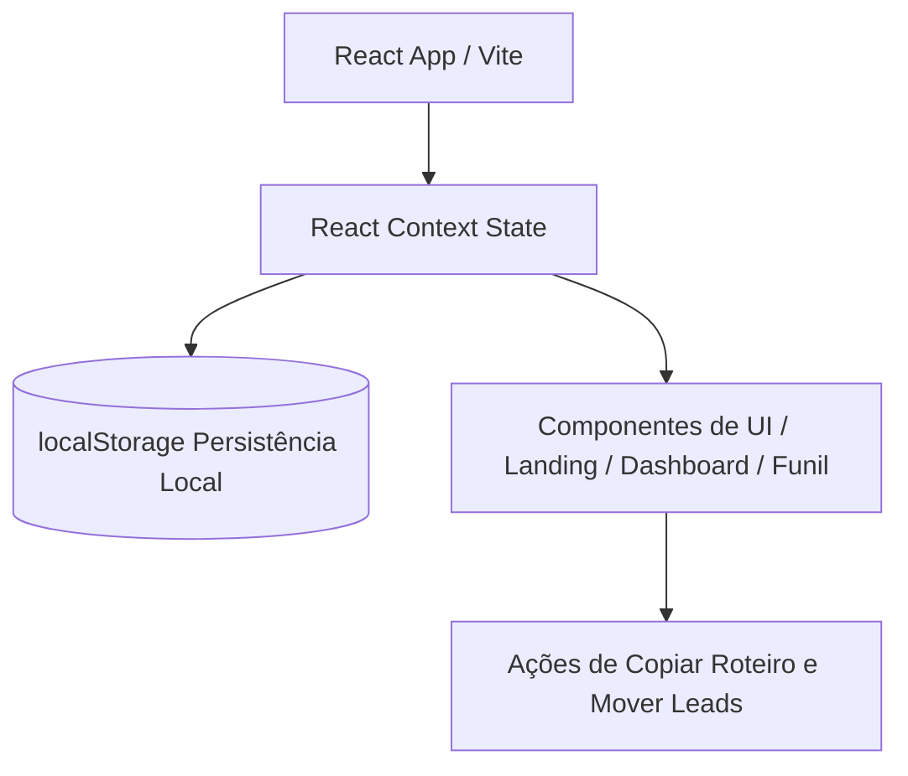

# PRD — LeadPilot AI

## 1. Overview

### Product Summary
LeadPilot AI é um mini SaaS local projetado para simular o fluxo de organização comercial, qualificação e acompanhamento (follow-up) de leads recebidos de canais digitais como WhatsApp e Instagram. 

### Objective
Este PRD descreve os requisitos funcionais e técnicos para um protótipo de alta fidelidade visual, offline-first e rodando 100% no cliente. Ele será usado em uma demonstração didática focada no comportamento e eficiência de agentes autônomos de desenvolvimento ao utilizarem o comando `/goal` com documentações ricas.

### Market Differentiation
Enquanto CRMs comuns são complexos, exigem infraestrutura pesada de banco de dados e conexões de rede constantes, o LeadPilot AI propõe um painel autocontido, de carregamento instantâneo, com foco cirúrgico na ação comercial diária de microempreendedores.

### Magic Moment
O usuário move o lead no pipeline Kanban de "Novo" para "Contato Inicial" e a barra de detalhes lateral atualiza no mesmo instante para sugerir um template de mensagem de follow-up pronto para ser copiado com um único clique.

### Success Criteria
* Execução em menos de 10 minutos por agentes autónomos de código.
* Sem dependências de conexões de backend.
* Tempo de carregamento menor que 1 segundo localmente.
* Interface visualmente impactante baseada em CSS Vanilla moderno.

---

## 2. Technical Architecture

### Architecture Overview
A aplicação é executada puramente no lado do cliente (Client-Side). Os dados simulados são carregados a partir de um arquivo estático de mocks e as alterações feitas pelo usuário durante a simulação são mantidas no estado do React (`useState` / `useContext`) e salvas no `localStorage` do navegador para simular a persistência de um banco de dados.



### Chosen Stack
| Layer | Choice | Rationale |
|---|---|---|
| Frontend | React + TypeScript + Vite | Velocidade de inicialização rápida, tipagem robusta e ótima performance de renderização no cliente. |
| Styling | CSS Moderno (Vanilla CSS) | Customização completa de efeitos de glow neon e transições sem a necessidade de compilação adicional de Tailwind. |
| Backend | None | Aplicação funciona 100% local no cliente. |
| Database | None (localStorage) | Persistência local simples em formato JSON. |
| Auth | None | Facilita o acesso rápido na demonstração sem telas de login. |
| Payments | None | Protótipo livre e gratuito para uso didático. |

### Stack Integration Guide
1. Inicializar o projeto utilizando a estrutura padrão do Vite com React e TypeScript.
2. Adicionar o arquivo `src/index.css` contendo as variáveis CSS de cor e os estilos globais da aplicação.
3. Configurar um React Context para gerenciar o estado global dos leads e da tela ativa (`activeTab`).
4. Inicializar o `localStorage` no Context carregando dados de mock caso não existam chaves persistidas.

### Repository Structure
```
project-root/
├── src/
│   ├── components/
│   │   ├── Sidebar.tsx        # Navegação lateral fixa
│   │   ├── LandingPage.tsx    # Tela institucional
│   │   ├── Dashboard.tsx      # Métricas e Gráficos de Funil
│   │   ├── Pipeline.tsx       # Funil Kanban de leads
│   │   ├── LeadList.tsx       # Tabela/Lista alternativa com filtros
│   │   ├── LeadDetails.tsx    # Barra lateral expansível
│   │   └── Settings.tsx       # Página de simulação / preferências
│   ├── context/
│   │   └── LeadContext.tsx    # Gerenciamento de estado global e localStorage
│   ├── data/
│   │   └── mockLeads.ts       # Mocks de leads iniciais
│   ├── index.css              # Variáveis de cor e estilos globais
│   ├── App.tsx                # Roteamento baseado em estado
│   └── main.tsx               # Ponto de entrada do React
└── docs/
    ├── product-vision.md
    ├── prd.md
    └── product-roadmap.md
```

### Infrastructure & Deployment
Deploys podem ser feitos instantaneamente e de forma gratuita em plataformas de hospedagem estática como Vercel ou Netlify apenas arrastando a pasta de build gerada pelo comando `npm run build`.

### Security Considerations
Sem armazenamento de chaves de APIs ou dados pessoais de produção. Os dados são puramente fictícios e salvos apenas no navegador do próprio usuário.

### Cost Estimate
Custo mensal de infraestrutura: **$0.00** (hospedagem gratuita na Vercel e zero infraestrutura de banco de dados).

---

## 3. Data Model

### Entity Definitions
A estrutura de dados principal representa um Lead:

```typescript
export interface Lead {
  id: string;               // Identificador único
  name: string;             // Nome do Lead
  company?: string;         // Empresa (opcional)
  email: string;            // E-mail para contato
  phone: string;            // Telefone formatado
  channel: 'WhatsApp' | 'Instagram' | 'Formulário' | 'Indicação'; // Canal de entrada
  temperature: 'Quente' | 'Morno' | 'Frio'; // Qualificação térmica
  status: 'Novo' | 'Contato Inicial' | 'Em Negociação' | 'Fechado' | 'Perdido'; // Colunas do Kanban
  score: number;            // Qualificação de 0 a 100 baseada na temperatura
  notes?: string;           // Notas internas/histórico
  createdAt: string;        // Data de cadastro formatada
}
```

### Relationships
Não se aplica, pois o modelo é desnormalizado e mantido em uma única coleção plana para garantir a simplicidade técnica.

### Indexes
Não se aplica no ambiente local, queries de filtros utilizam JavaScript arrays (`filter` e `sort`).

---

## 4. API Specification

### API Design Philosophy
Sem conexões HTTP de rede reais. O gerenciamento é feito por meio de chamadas de funções locais simulando chamadas assíncronas com promessas de mentira (opcional, para emular latência de carregamento de forma controlada).

### Endpoints (Simulados em Funções Locais)
* `getLeads(): Promise<Lead[]>`: Retorna a lista completa de leads contidos no estado global.
* `updateLeadStatus(id: string, status: Lead['status']): Promise<Lead>`: Modifica o status do lead no Kanban e recalcula a recomendação de follow-up.
* `updateLeadTemperature(id: string, temperature: Lead['temperature']): Promise<Lead>`: Modifica a temperatura e o lead score do contato.

---

## 5. User Stories

### Epic: Visualização Comercial e Cockpit
**US-001: Visualizar Funil de Vendas**
As a Mariana, I want to visualizar meus leads em um pipeline Kanban segmentado por colunas so that eu possa identificar rapidamente o estágio comercial de cada contato.
* Acceptance Criteria:
  * Exibir colunas correspondentes a: Novo, Contato Inicial, Em Negociação e Fechado/Perdido.
  * Cards devem conter o nome do contato, canal com ícone visual e tag colorida de temperatura.

**US-002: Detalhar Lead e Visualizar Follow-up Recomendado**
As a Mariana, I want to clicar em um lead do funil e abrir um painel lateral de detalhes so that eu possa ver seu histórico comercial, score térmico e copiar um roteiro de mensagem imediato para envio rápido.
* Acceptance Criteria:
  * O painel lateral deve se abrir sobre a tela sem quebrar o layout.
  * Exibir o botão "Copiar Mensagem" que armazena o template na área de transferência com feedback visual de sucesso ("Copiado!").
  * O template de mensagem deve mudar de acordo com o status atual do lead (Novo -> Mensagem de boas-vindas, Em Negociação -> Lembrete de proposta, etc.).

---

## 6. Functional Requirements

**FR-001: Barra de Navegação Lateral (Sidebar)**
Priority: P0
Description: Permite alternar rapidamente entre a Landing Page do produto (institucional), o Dashboard de métricas, o Pipeline Kanban de vendas, a lista tabular de leads e a tela de configurações.
Acceptance Criteria:
* Menu fixo na lateral esquerda.
* Destaque visual da opção selecionada.
* Transição de abas controlada localmente sem recarregar a página.

**FR-002: Dashboard Comercial de Métricas**
Priority: P0
Description: Exibe cartões informativos com dados compilados dos leads para análise visual do funil comercial.
Acceptance Criteria:
* Exibir: Total de Leads, Contatos Quentes, Leads Convertidos (Fechados) e Gráfico representativo do funil (composto por barras CSS).
* Os dados devem ser sincronizados dinamicamente se o usuário alterar o status de algum lead no pipeline.

**FR-003: Biblioteca de Roteiros de Mensagens e Cópia**
Priority: P0
Description: Exibe templates prontos baseados na temperatura e status comercial selecionado, com recurso de cópia rápida.
Acceptance Criteria:
* Um clique no botão de cópia adiciona o texto formatado à área de transferência do sistema operacional.
* Mostrar uma mensagem toast rápida de sucesso.

---

## 7. Non-Functional Requirements

### Performance
* A renderização de cards e alternâncias de abas deve ocorrer em menos de 100ms.
* Zero chamadas externas de rede para iniciar o fluxo da aplicação.

### Security
* Não há armazenamento de credenciais de produção de nenhuma espécie.
* Dados são armazenados estritamente na memória e no sandboxed `localStorage` do navegador do cliente.

### Accessibility
* Contraste de cores em conformidade com as regras de design moderno e visual premium.
* Botões interativos devem responder a foco de teclado e clique normal.

### Scalability
* O sistema é projetado para lidar com até 100 leads mockados na lista local sem qualquer degradação de performance.

### Reliability
* Resiliência a falhas de dados carregando sempre o conjunto de dados mockados inicial caso o `localStorage` do usuário esteja corrompido ou vazio.

---

## 8. UI/UX Requirements

Visual design tokens not yet defined. Run `/plaid design` before implementation begins. A interface usará um tema escuro e moderno com cantos arredondados, gradientes suaves e glows de neon verde e lilás.

### Screen: Landing Page
Route: `/` (Aba default ou inicial antes de clicar em "Entrar no Cockpit")
* Layout: Header centralizado, título de impacto (Hero Section), ilustrações esquemáticas dos recursos do app e botão CTA principal em destaque ("Acessar Painel").

### Screen: Funil Pipeline (Kanban)
Route: `/pipeline`
* Layout: Header superior com botão de alternância para lista, filtros rápidos por temperatura (Todos, Quente, Morno, Frio). 4 colunas verticais com fundo cinza translúcido escuro.
* States:
  * **Populated**: Cards elegantes de leads organizados verticalmente dentro de suas respectivas colunas de progresso.
  * **Empty**: Coluna vazia exibe mensagem centralizada com opacidade discreta indicando "Nenhum lead nesta fase".

### Screen: Painel Lateral (Slide-over Panel)
* Layout: Barra lateral direita deslizável que sobrepõe a tela atual.
* Key Interactions:
  * Exibe informações pessoais do lead, score (ex: 85/100) estilizado em formato circular ou barra de progresso.
  * Exibe área com texto do template e botão principal "Copiar Roteiro de Mensagem".
  * Exibe botões rápidos para alterar a temperatura do lead diretamente na barra lateral, atualizando o score imediatamente.

---

## 9. Auth Implementation

This app does not require authentication. If auth is added later, revisit this section.

---

## 10. Payment Integration

This app is completely free. Payment integrations are out of scope.

---

## 11. Edge Cases & Error Handling

### Feature: Copiar Mensagem
| Scenario | Expected Behavior | Priority |
|---|---|---|
| Permissão de Clipboard negada pelo navegador | Exibir toast avisando "Não foi possível copiar automaticamente. Selecione e copie o texto manualmente." | P1 |
| localStorage indisponível/bloqueado no navegador | Salvar dados apenas em memória React (os dados serão resetados ao atualizar a página, mas o app funcionará). | P0 |

---

## 12. Dependencies & Integrations

### Core Dependencies
Não usar frameworks complexos ou que exijam dependências profundas na nuvem. Usar apenas:
```json
{
  "react": "^18.x.x",
  "react-dom": "^18.x.x",
  "lucide-react": "^0.x.x"
}
```
*(Utilizar lucide-react para renderização rápida e bonita de ícones de canais e navegação).*

### Development Dependencies
```json
{
  "typescript": "^5.x.x",
  "vite": "^5.x.x"
}
```

### Third-Party Services
Nenhum serviço externo ativo ou requerido.

---

## 13. Out of Scope

* Integrações com WhatsApp API, Instagram Graph ou e-mails reais.
* Banco de dados em nuvem, backend e processos de login.
* Gateway de pagamentos (Stripe).
* Conexão com modelos de linguagem (OpenAI) e ferramentas de fluxos como n8n.

---

## 14. Open Questions

1. **Implementação de Drag and Drop**: Para garantir a velocidade de build (5-10 minutos) do agente de código no vídeo, devemos priorizar botões de setas de atalho rápidos nos cards para mover leads entre colunas, ao invés de codificar drags complexos que dependem de bibliotecas adicionais. *Decisão Padrão*: Adotar botões rápidos de troca de status e HTML5 drag-and-drop nativo apenas se for leve e rápido de gerar.
2. **Design System**: A estilização usará CSS puro modular ou arquivo global único `index.css` com classes customizadas? *Decisão Padrão*: Arquivo `src/index.css` centralizando as variáveis do design system para facilitar a leitura e edição pelo agente de código.
